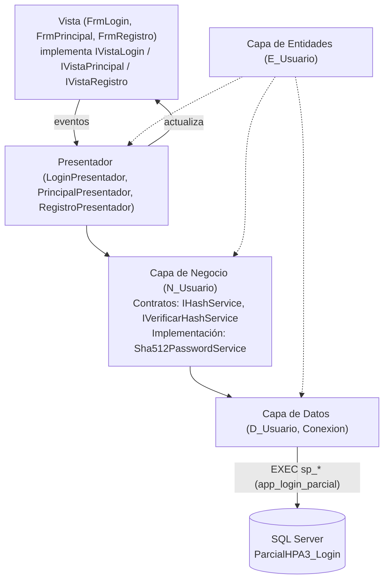

# 🔐 Login de Usuario en Capas con Patrón MVP

**Herramientas de la Programación Aplicada III (.NET) — Parcial Práctico**
Universidad Tecnológica de Panamá · Facultad de Ingeniería en Sistemas · Campus Víctor Levi Sasso

| | |
|---|---|
| **Autor** | Michael Hunt |
| **Grupo** | 1IL133 |
| **Instructora** | Ing. Irina Fong |
| **Fecha** | 8 de noviembre de 2026 |
| **Semestre** | II Semestre 2026 |

---

## 📋 Descripción

Aplicación de escritorio **Windows Forms** que implementa un sistema de inicio de sesión y registro de usuarios usando **programación en capas** y el patrón de diseño **MVP (Modelo–Vista–Presentador)**.

- Las contraseñas se guardan como **hash SHA-512 con salt** (`VARBINARY(64)`), nunca en texto plano.
- La capa de Negocio define **dos contratos independientes**: `IHashService` (generar hash) e `IVerificarHashService` (verificar hash).
- La aplicación se conecta a SQL Server con una **cuenta específica de privilegios mínimos** que solo puede ejecutar dos procedimientos almacenados.
- Interfaz moderna sin bordes con **menú lateral animado**, **hora actual** y el **usuario en sesión** en la parte inferior del menú (basado en el video de referencia de RJ Code Advance).

---

## 🛠️ Tecnologías y versiones

| Tecnología | Versión |
|---|---|
| Lenguaje | C# 14 |
| Framework | .NET 10 (`net10.0` / `net10.0-windows`) |
| Tipo de aplicación | Windows Forms |
| IDE | Visual Studio 2026 (v18) |
| Gestor de base de datos | SQL Server 2022 Express (16.0) — instancia `.\SQLEXPRESS` |
| Herramientas de BD | SQL Server Management Studio (SSMS) / `sqlcmd` |
| NuGet: acceso a datos | `Microsoft.Data.SqlClient` 7.1.1 |
| NuGet: configuración | `System.Configuration.ConfigurationManager` 10.0.14 |
| NuGet: seguridad | `System.Security.Cryptography.Pkcs` 10.0.14 (fija versión parcheada) |
| Criptografía | `System.Security.Cryptography` (SHA-512, `RandomNumberGenerator`) |
| Control de versiones | Git |

---

## 🏛️ Arquitectura en capas



```
Parcial_HPA3_Capas/
├── CapaEntidades/          E_Usuario.cs
├── CapaDatos/              Conexion.cs, D_Usuario.cs
├── CapaNegocio/
│   ├── Contratos/          IHashService.cs, IVerificarHashService.cs
│   ├── Servicios/          Sha512PasswordService.cs
│   └── N_Usuario.cs
├── CapaPresentacion/
│   ├── Vistas/             IVistaLogin.cs, IVistaPrincipal.cs, IVistaRegistro.cs
│   ├── Presentadores/      LoginPresentador.cs, PrincipalPresentador.cs, RegistroPresentador.cs
│   ├── Sesion/             SesionUsuario.cs
│   ├── FrmLogin, FrmPrincipal, FrmInicio, FrmRegistro
│   ├── Estilo.cs           colores, iconos y arrastre de ventana
│   ├── App.config          cadena de conexión
│   └── Program.cs          raíz de composición
├── BaseDatos/script.sql
└── docs/img/               capturas
```

| Capa | Responsabilidad |
|---|---|
| **Entidades** | Clases puras de datos (`E_Usuario`: Id, Usuario, PasswordHash, Salt, Nombre, Estado…). |
| **Datos** | Conexión a SQL Server y ejecución de procedimientos almacenados con parámetros. |
| **Negocio** | Reglas de negocio y seguridad: validaciones, generación y verificación del hash mediante interfaces. |
| **Presentación (MVP)** | **Vista**: solo controles y eventos, no conoce el hash ni la BD. **Presentador**: recibe la acción de la vista, llama a Negocio y devuelve el resultado a la vista. |

### Contratos de la capa de Negocio

```csharp
public interface IHashService            // única responsabilidad: GENERAR
{
    byte[] GenerarSalt();
    byte[] GenerarHash(string password, byte[] salt);
}

public interface IVerificarHashService   // única responsabilidad: VERIFICAR
{
    bool Verificar(string password, byte[] hashGuardado, byte[] salt);
}
```

`Sha512PasswordService` implementa ambos contratos con `SHA512(salt ‖ password)`, que es exactamente el mismo cálculo que `HASHBYTES('SHA2_512', salt + password)` en SQL Server. La verificación usa `CryptographicOperations.FixedTimeEquals` (comparación en tiempo constante). `N_Usuario` recibe las interfaces por constructor, de modo que si mañana se cambia a BCrypt o Argon2 solo se reemplaza esa clase en `Program.cs`, sin tocar la Vista, el Presentador ni la base de datos.

### Conexión con privilegios mínimos

La aplicación **no** usa `sa` ni la cuenta de Windows del administrador. El script crea:

| Objeto | Permisos |
|---|---|
| Login `app_login_parcial` → usuario `app_user` | `GRANT EXECUTE` solo sobre `sp_ObtenerUsuario` y `sp_InsertarUsuario` |
| Tabla `dbo.usuarios` | `DENY SELECT, INSERT, UPDATE, DELETE` para `app_user` |

Prueba hecha: con `EXECUTE AS USER = 'app_user'`, un `SELECT * FROM usuarios` responde *"The SELECT permission was denied on the object 'usuarios'"*, mientras que `EXEC sp_ObtenerUsuario 'admin'` funciona.

---

## 🧩 Controles utilizados

| Control | Uso |
|---|---|
| `Form` (sin bordes, `FormBorderStyle.None`) | Login, ventana principal y formularios hijos |
| `Panel` | Menú lateral, barra de título, panel contenedor, panel de sesión |
| `Button` (`FlatStyle.Flat`) | Opciones del menú, hamburguesa, cerrar/maximizar/minimizar, ingresar, registrar |
| `Label` | Títulos, hora, fecha, usuario en sesión, mensajes de validación, iconos |
| `TextBox` (`UseSystemPasswordChar`) | Usuario, nombre y contraseñas |
| `CheckBox` | Mostrar/ocultar contraseña |
| `ErrorProvider` | Marcar campos vacíos en el login |
| `Timer` | Reloj (1 s) y animación del menú lateral (10 ms) |

---

## ⚙️ Instalación y ejecución

### Requisitos
- Windows 10/11
- Visual Studio 2026 (o 2022 17.14+) con la carga de trabajo **Desarrollo de escritorio de .NET**
- .NET 10 SDK
- SQL Server 2022 Express + SSMS

### 1. Clonar el repositorio
```bash
git clone <url-del-repositorio>
cd Parcial_HPA3_Capas
```

### 2. Activar la autenticación mixta en SQL Server
El login de privilegios mínimos es un login de SQL Server, así que el servidor debe aceptar ambos tipos de autenticación:
1. En SSMS, conectarse a `.\SQLEXPRESS` → clic derecho en el servidor → **Propiedades** → **Seguridad**.
2. Seleccionar **Modo de autenticación de SQL Server y de Windows** → Aceptar.
3. Reiniciar el servicio **SQL Server (SQLEXPRESS)** (desde SSMS: clic derecho → Reiniciar, o en `services.msc`).

### 3. Crear la base de datos
Abrir `BaseDatos/script.sql` en SSMS y ejecutarlo (F5), o desde la terminal:
```bash
sqlcmd -S .\SQLEXPRESS -E -i BaseDatos\script.sql
```
Esto crea la BD `ParcialHPA3_Login`, la tabla `usuarios`, los procedimientos almacenados, los usuarios de prueba y la cuenta de privilegios mínimos.

### 4. Revisar la cadena de conexión
En `CapaPresentacion/App.config` (cambiar `Server` si se usa otra instancia):
```xml
<add name="ConexionApp"
     connectionString="Server=.\SQLEXPRESS;Database=ParcialHPA3_Login;User Id=app_login_parcial;Password=Parcial#HPA3_2026;TrustServerCertificate=True;Application Name=ParcialHPA3" />
```

### 5. Ejecutar
- Abrir `Parcial_HPA3_Capas.slnx` en Visual Studio, establecer **CapaPresentacion** como proyecto de inicio y presionar **F5**.
- O desde la terminal: `dotnet run --project CapaPresentacion`

### Usuarios de prueba
| Usuario | Contraseña | Estado |
|---|---|---|
| `admin` | `123456` | Activo |
| `inactivo` | `123456` | Inactivo (para probar la validación) |

---

## 🖼️ Capturas de resultado

### Inicio de sesión


### Menú lateral, hora actual y usuario en sesión


### Menú lateral contraído


### Registro de usuario


### Validaciones
| Campos vacíos | Credenciales incorrectas |
|---|---|
|  |  |

| Usuario inactivo | Contraseñas no coinciden / muy corta |
|---|---|
|  |  |

### Base de datos (hash almacenado y privilegios mínimos)


---

## ✅ Validaciones implementadas

| Dónde | Validación | Mensaje |
|---|---|---|
| Login (Presentador) | Usuario o contraseña vacíos | "Complete los campos obligatorios." + `ErrorProvider` |
| Login (Negocio) | Usuario no existe o contraseña incorrecta | "Usuario o contraseña incorrectos." |
| Login (Negocio) | Usuario con `dsEstado = 0` | "El usuario está inactivo…" |
| Registro (Negocio) | Campos vacíos | "Todos los campos son obligatorios." |
| Registro (Negocio) | Contraseña de menos de 6 caracteres | "La contraseña debe tener al menos 6 caracteres." |
| Registro (Negocio) | Confirmación distinta | "Las contraseñas no coinciden." |
| Registro (Negocio) | Usuario repetido | "El nombre de usuario ya existe." |
| Datos / Presentador | Sin conexión a la BD | "No se pudo conectar con la base de datos: …" |

---

## 📚 Referencias
- Ing. Irina Fong — *Laboratorio: Login de Usuario, Programación en capas* y *Rúbrica de Capas (Parcial Práctico)*.
- RJ Code Advance ES — [Formulario Plano Moderno, Menú animado, C#, WinForm](https://www.youtube.com/watch?v=y1jftnTaTXU)
- Microsoft Learn — [HASHBYTES (Transact-SQL)](https://learn.microsoft.com/sql/t-sql/functions/hashbytes-transact-sql), [Microsoft.Data.SqlClient](https://learn.microsoft.com/sql/connect/ado-net/introduction-microsoft-data-sqlclient-namespace)

---

<sub>Elaborado por **Michael Hunt** · 1IL133 · 8 de noviembre de 2026</sub>
