# 🏢 HPA3 ERP — Sistema ERP en Capas con Patrón MVP

**Herramientas de la Programación Aplicada III (.NET) — Parcial Práctico**
Universidad Tecnológica de Panamá · Facultad de Ingeniería en Sistemas · Campus Víctor Levi Sasso

| | |
|---|---|
| **Autor** | Michael Hunt |
| **Grupo** | 1IL133 |
| **Instructora** | Ing. Irina Fong |
| **Fecha** | 8 de noviembre de 2026 |
| **Semestre** | II Semestre 2026 |

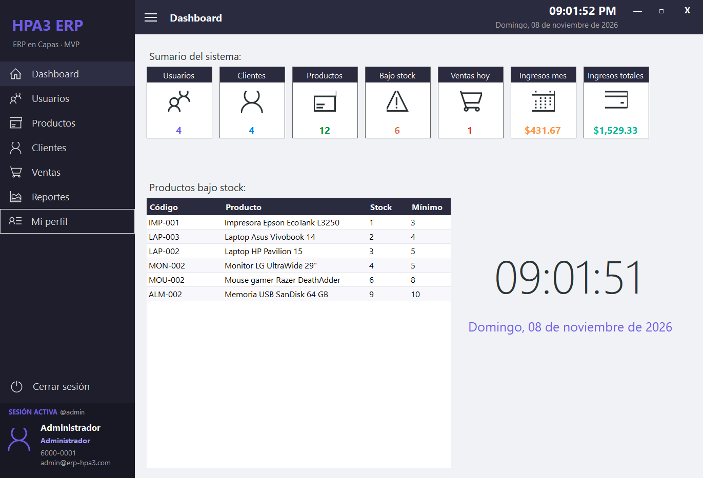

---

## 📋 Descripción

Aplicación de escritorio **Windows Forms** que empezó como el *Login en capas* del laboratorio y se amplió a un **mini ERP** con **tres tipos de usuario** (Administrador, Vendedor y Cliente). Cumple todas las pautas del parcial:

| Pauta del parcial | Cómo se cumple |
|---|---|
| Patrón de diseño **MVP** | Cada pantalla es una *Vista* que implementa una interfaz (`IVistaLogin`, `IVistaVentas`, …) y tiene su *Presentador*. Las vistas no conocen la base de datos ni el algoritmo de hash. |
| **Dos contratos** en la capa de Negocio: generar y verificar hash | `IHashService` (generar) e `IVerificarHashService` (verificar), implementados por `Sha512PasswordService` (SHA‑512 + salt). |
| **Conexión específica con privilegios mínimos** | La app se conecta con el login `app_login_erp`, que **solo puede ejecutar procedimientos almacenados** y tiene `DENY` sobre todas las tablas. |
| **Menú lateral izquierdo + hora actual** | Formulario plano sin bordes con menú lateral animado (estilo RJ Code Advance), reloj en la barra superior y reloj grande en el dashboard. |
| **Quién inició sesión, en la parte inferior** | Panel "SESIÓN ACTIVA" abajo del menú con avatar, nombre, rol, teléfono y correo. |
| Repositorio, documentación y README | Código comentado con `///`, este README con imágenes, y pruebas unitarias. |

---

## 👥 Roles y permisos

| Módulo | Administrador | Vendedor | Cliente |
|---|:---:|:---:|:---:|
| Dashboard | ✔ resumen global | ✔ sus ventas | ✔ sus compras |
| Usuarios (CRUD) | ✔ | — | — |
| Productos (CRUD) | ✔ | 👁 solo consulta | — |
| Clientes (CRUD) | ✔ | ✔ | — |
| Ventas (nueva + historial) | ✔ | ✔ | — |
| Comprar (carrito) | — | — | ✔ |
| Mis compras | — | — | ✔ |
| Reportes | ✔ | — | — |
| Mi perfil (cambiar contraseña) | ✔ | ✔ | ✔ |

Los permisos están en `CapaNegocio/Permisos.cs`. La capa de **Negocio** los valida en cada operación (aunque alguien intentara llamar una acción sin permiso, se rechaza) y la **Presentación** los usa para construir el menú con solo las opciones permitidas. Desde el login, cualquier persona puede **crear una cuenta de cliente**.

---

## 🛠️ Tecnologías y versiones

| Tecnología | Versión |
|---|---|
| Lenguaje | C# 14 |
| Framework | .NET 10 (`net10.0` / `net10.0-windows`) |
| Tipo de aplicación | Windows Forms |
| IDE | Visual Studio 2026 (v18) |
| Base de datos | SQL Server 2022 Express (16.0) — instancia `.\SQLEXPRESS` |
| Herramientas de BD | SQL Server Management Studio / `sqlcmd` |
| NuGet: acceso a datos | `Microsoft.Data.SqlClient` 7.1.1 |
| NuGet: configuración | `System.Configuration.ConfigurationManager` 10.0.14 |
| NuGet: seguridad | `System.Security.Cryptography.Pkcs` 10.0.14 (fija una versión sin vulnerabilidades) |
| Pruebas unitarias | xUnit 2.9.3 · Microsoft.NET.Test.Sdk 17.14.1 |
| Criptografía | `System.Security.Cryptography` (SHA‑512, `RandomNumberGenerator`, `FixedTimeEquals`) |
| Control de versiones | Git + GitHub |

---

## 🏛️ Arquitectura en capas

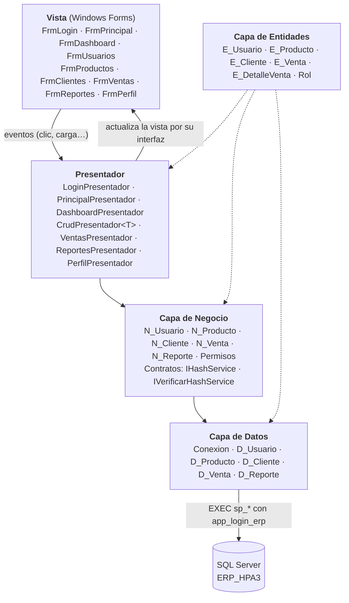

```
Parcial_HPA3_Capas/
├── CapaEntidades/        E_Usuario, E_Producto, E_Cliente, E_Venta, E_DetalleVenta, Rol...
├── CapaDatos/            Conexion, D_Usuario, D_Producto, D_Cliente, D_Venta, D_Reporte
├── CapaNegocio/
│   ├── Contratos/        IHashService, IVerificarHashService
│   ├── Servicios/        Sha512PasswordService
│   ├── N_Usuario, N_Producto, N_Cliente, N_Venta, N_Reporte
│   └── Permisos, Validar, Resultado, Formato
├── CapaNegocio.Tests/    Pruebas unitarias xUnit (33 pruebas)
├── CapaPresentacion/
│   ├── Vistas/           Interfaces de las vistas (IVistaLogin, IVistaCrud<T>, IVistaVentas...)
│   ├── Presentadores/    Un presentador por pantalla + CrudPresentador<T> reutilizable
│   ├── Sesion/           SesionUsuario (usuario logueado)
│   ├── Frm*.cs           Formularios (Vistas)
│   ├── Servicios.cs      Raíz de composición (crea Negocio y conecta Vista + Presentador)
│   └── App.config        Cadena de conexión
├── BaseDatos/script.sql  Tablas, procedimientos, datos de ejemplo y usuario de privilegios mínimos
└── docs/img/             Capturas
```

| Capa | Responsabilidad |
|---|---|
| **Entidades** | Clases puras que representan los datos. |
| **Datos** | Abre la conexión y ejecuta **solo procedimientos almacenados** con parámetros tipados (sin SQL concatenado). Los errores de regla que lanzan los procedimientos (`THROW 50000+`) se convierten en mensajes para el usuario. |
| **Negocio** | Reglas y seguridad: permisos por rol, validaciones, cálculo del ITBMS, carrito, y generación/verificación del hash mediante interfaces. |
| **Presentación (MVP)** | **Vista**: controles y eventos. **Presentador**: recibe la acción, llama a Negocio y le devuelve el resultado a la vista. |

### Contratos de hash (capa de Negocio)

```csharp
public interface IHashService            // única responsabilidad: GENERAR
{
    byte[] GenerarSalt();
    byte[] GenerarHash(string password, byte[] salt);
}

public interface IVerificarHashService   // única responsabilidad: VERIFICAR
{
    bool Verificar(string password, byte[] hashGuardado, byte[] salt);
}
```

- `Sha512PasswordService` implementa ambos con `SHA512(salt ‖ password)`, el mismo cálculo que `HASHBYTES('SHA2_512', salt + password)` en SQL Server, así que los usuarios creados por el script pueden iniciar sesión desde la app. Una prueba unitaria lo comprueba con un hash generado en SQL Server.
- **Dónde se usa cada contrato:** registro de usuario → `GenerarSalt` + `GenerarHash`; login → `Verificar`; cambio de contraseña → `Verificar` la actual y `GenerarHash` la nueva.
- `N_Usuario` recibe las dos interfaces por constructor. Para cambiar a BCrypt o Argon2 basta con otra clase que las implemente y cambiar una línea en `Program.cs`.
- La verificación usa `CryptographicOperations.FixedTimeEquals` (comparación en tiempo constante).

### Conexión con privilegios mínimos

| Objeto | Permisos |
|---|---|
| Login `app_login_erp` → usuario `app_user` | `GRANT EXECUTE` **uno por uno** sobre los 21 procedimientos de la app y sobre el tipo tabla `DetalleVentaTipo` |
| Tablas `roles`, `usuarios`, `clientes`, `productos`, `ventas`, `detalle_venta` | `DENY SELECT, INSERT, UPDATE, DELETE` para `app_user` |

Probado con `EXECUTE AS USER = 'app_user'`: un `SELECT * FROM productos` responde *"The SELECT permission was denied"*, mientras que `EXEC sp_InsertarVenta …` funciona. La app nunca usa `sa` ni la cuenta de Windows del administrador.

---

## 🗄️ Base de datos

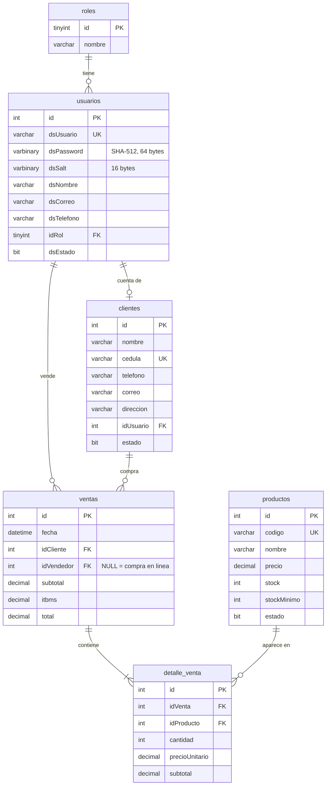

**Procedimientos almacenados** (únicos puntos de acceso de la app):

| Módulo | Procedimientos |
|---|---|
| Usuarios | `sp_ObtenerUsuario`, `sp_ListarUsuarios`, `sp_InsertarUsuario`, `sp_ActualizarUsuario`, `sp_CambiarPassword`, `sp_EliminarUsuario` |
| Productos | `sp_ListarProductos`, `sp_InsertarProducto`, `sp_ActualizarProducto`, `sp_EliminarProducto`, `sp_ProductosBajoStock` |
| Clientes | `sp_ListarClientes`, `sp_InsertarCliente`, `sp_ActualizarCliente`, `sp_EliminarCliente` |
| Ventas | `sp_InsertarVenta` (transacción: valida stock con bloqueo, toma el precio de la BD, calcula ITBMS y descuenta inventario), `sp_ListarVentas`, `sp_DetalleVenta` |
| Dashboard / Reportes | `sp_ResumenDashboard` (cifras filtradas por rol), `sp_ReporteVentasPorProducto`, `sp_ReporteVentasPorVendedor` |

El carrito se envía en una sola llamada con un **parámetro con valor de tabla** (`dbo.DetalleVentaTipo`).

---

## 🖼️ Capturas de resultado

### Inicio de sesión
| Login | Campos vacíos |
|---|---|
| 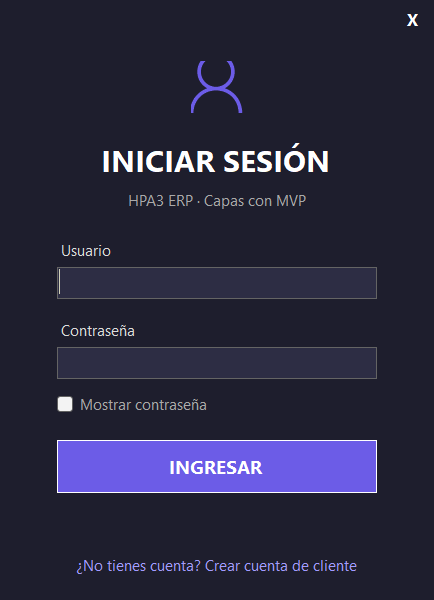 | 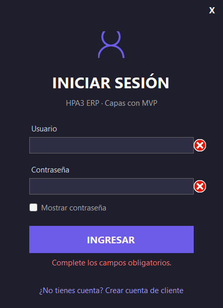 |

### Administrador
**Dashboard** — tarjetas "Sumario del sistema", productos bajo stock y reloj grande; menú lateral con la sesión activa abajo:


| Menú lateral contraído | Usuarios (CRUD) |
|---|---|
| 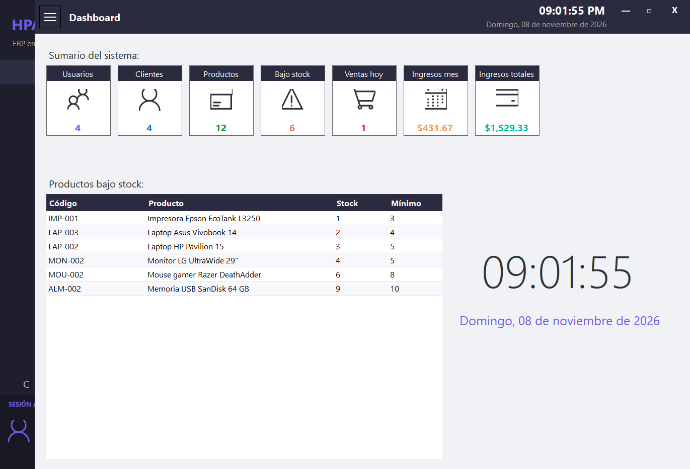 | 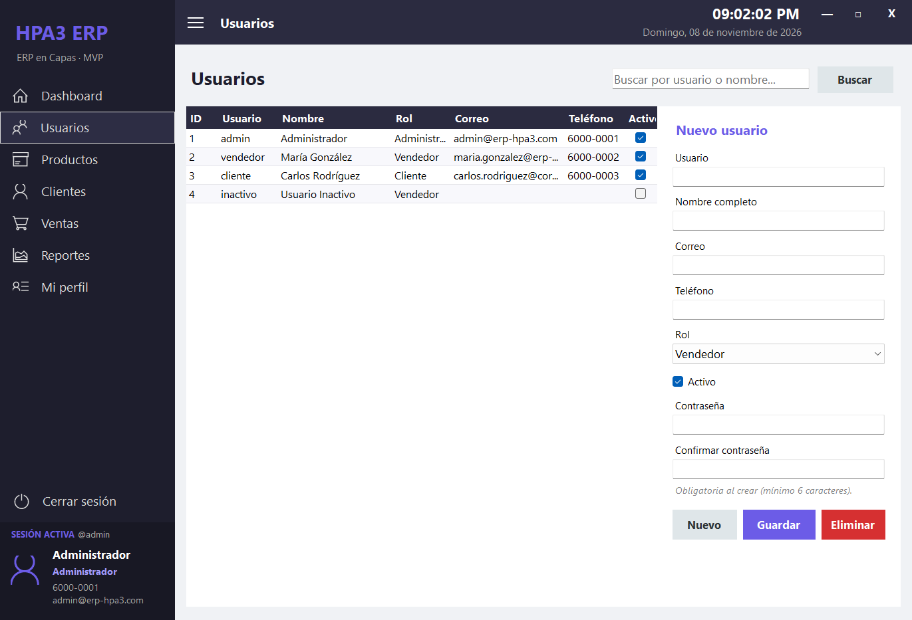 |

| Productos (bajo stock en rojo) | Clientes |
|---|---|
| 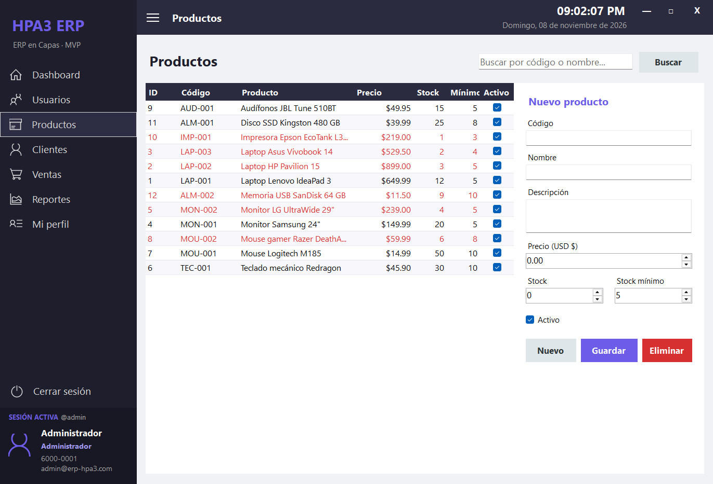 | 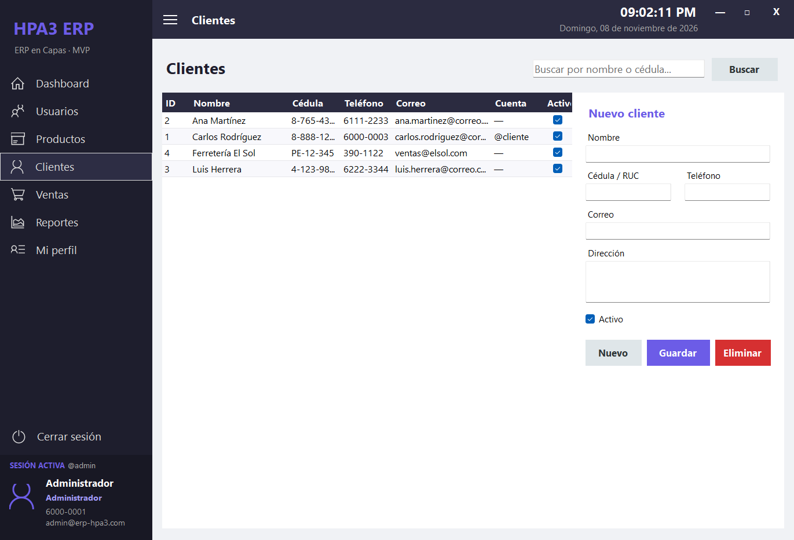 |

| Ventas | Reportes con gráfico |
|---|---|
| 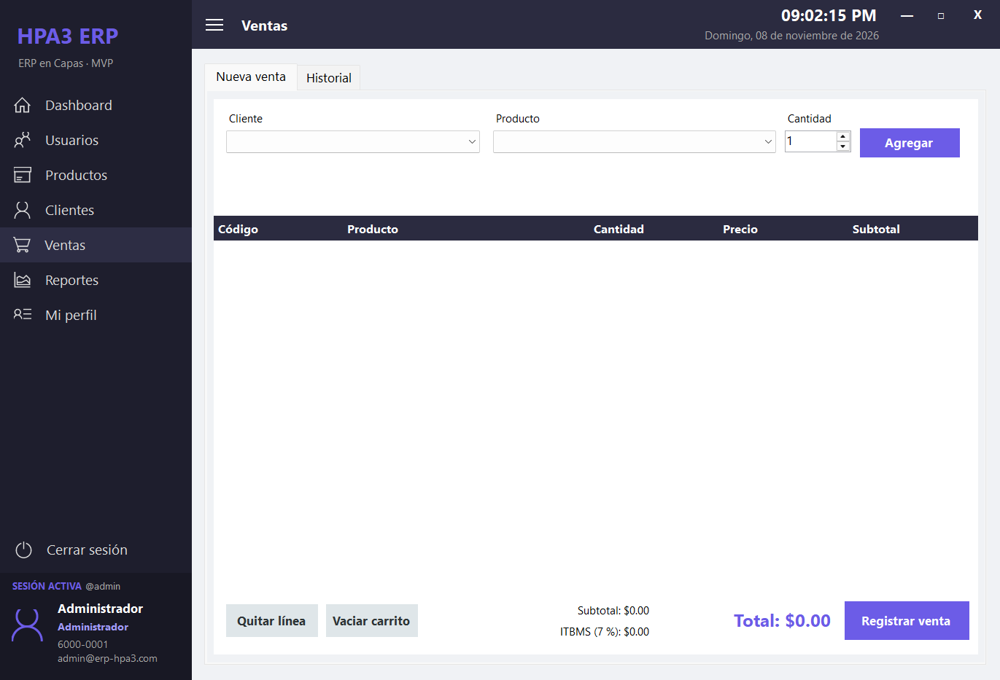 | 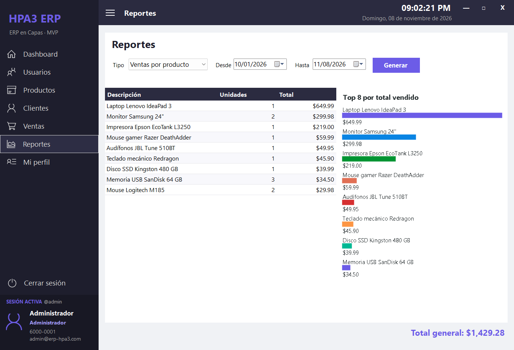 |

| Mi perfil (cambio de contraseña) |
|---|
| 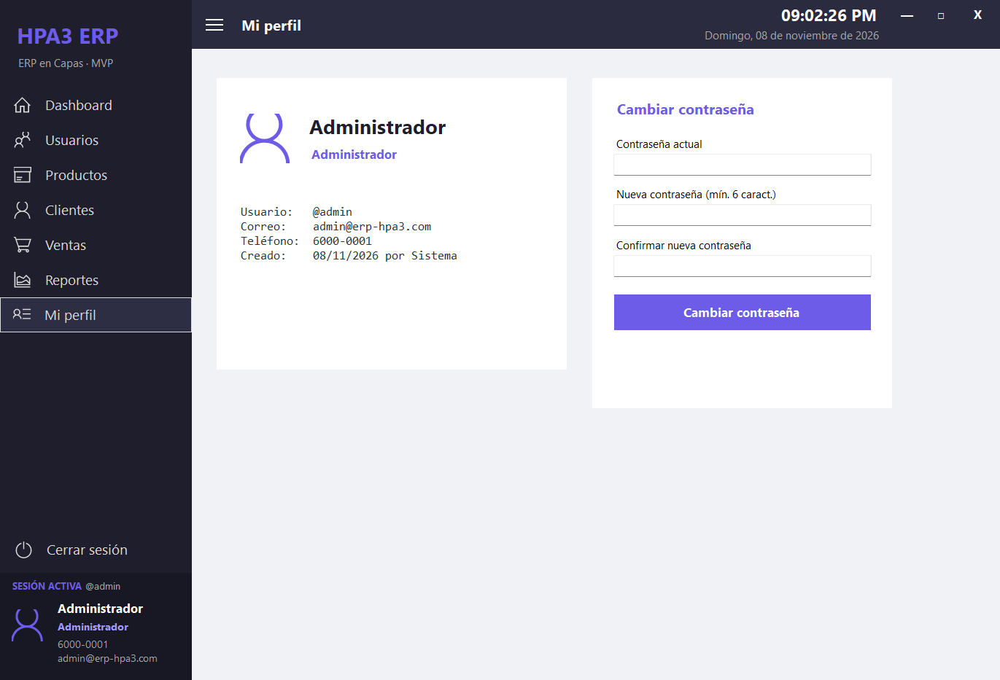 |

### Vendedor
| Dashboard con sus ventas | Productos en modo solo consulta |
|---|---|
| 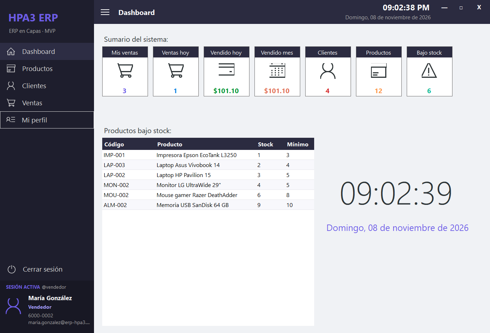 | 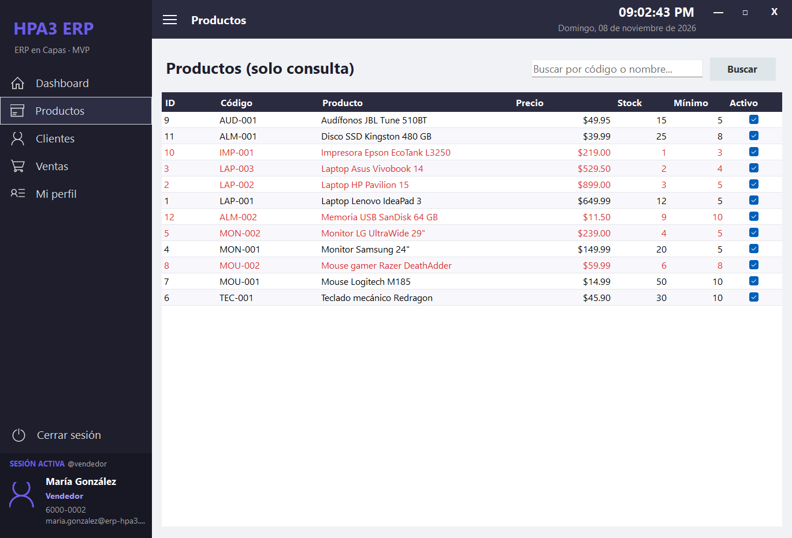 |

### Cliente
| Dashboard con sus compras | Comprar (carrito con ITBMS) |
|---|---|
| 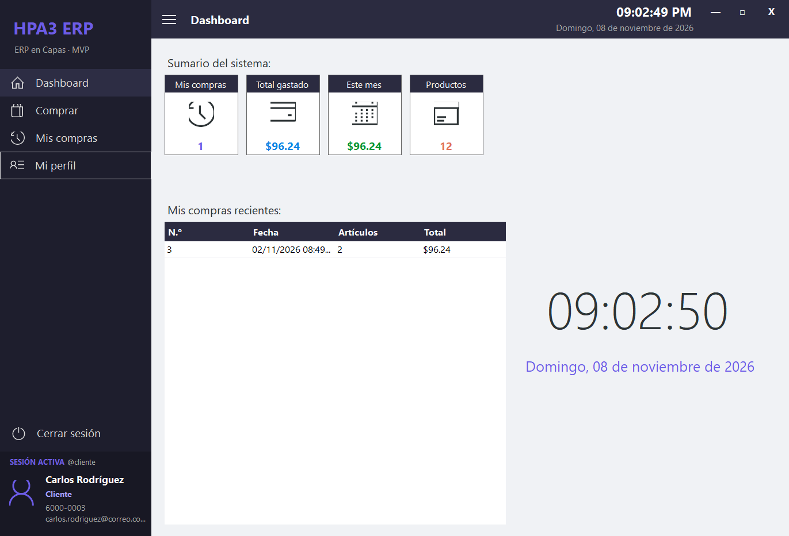 | 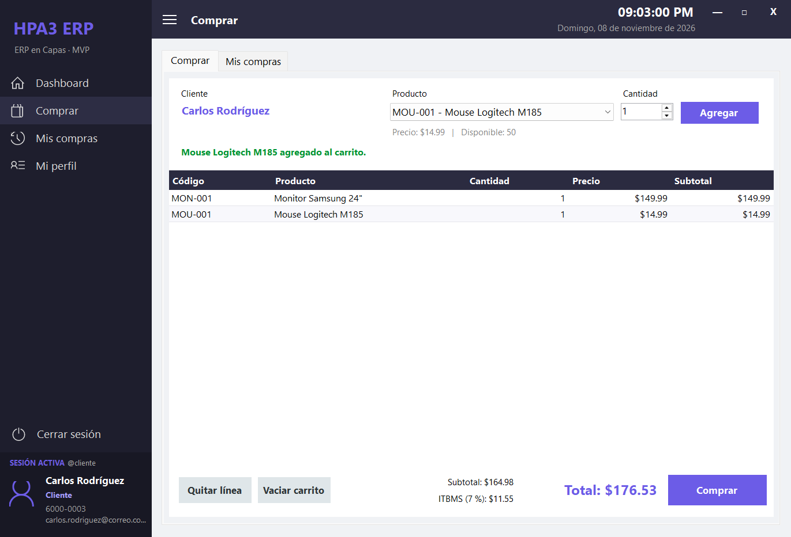 |

| Mis compras |
|---|
| 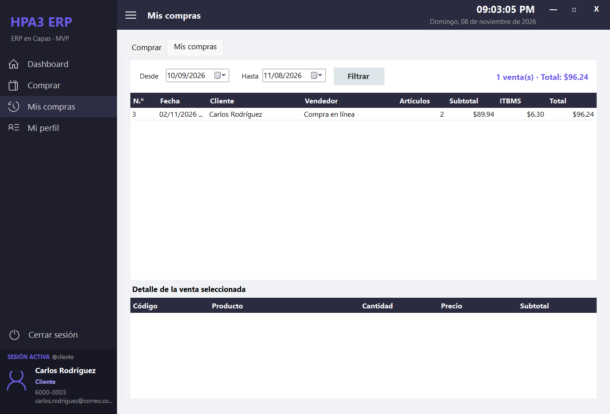 |

### Validaciones
| Credenciales incorrectas | Usuario inactivo | Contraseña muy corta |
|---|---|---|
| 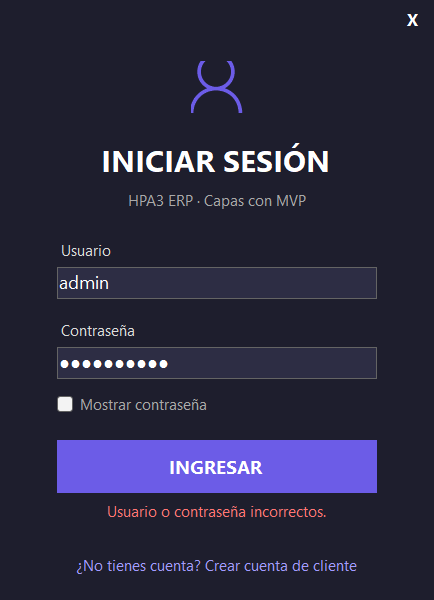 | 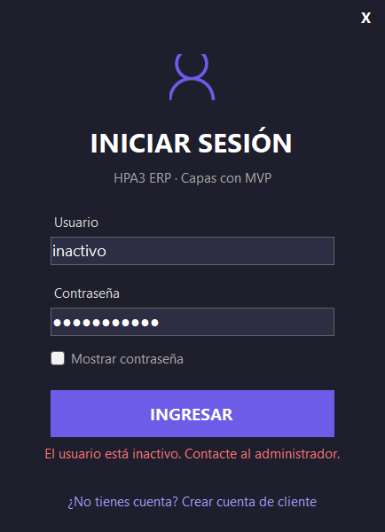 | 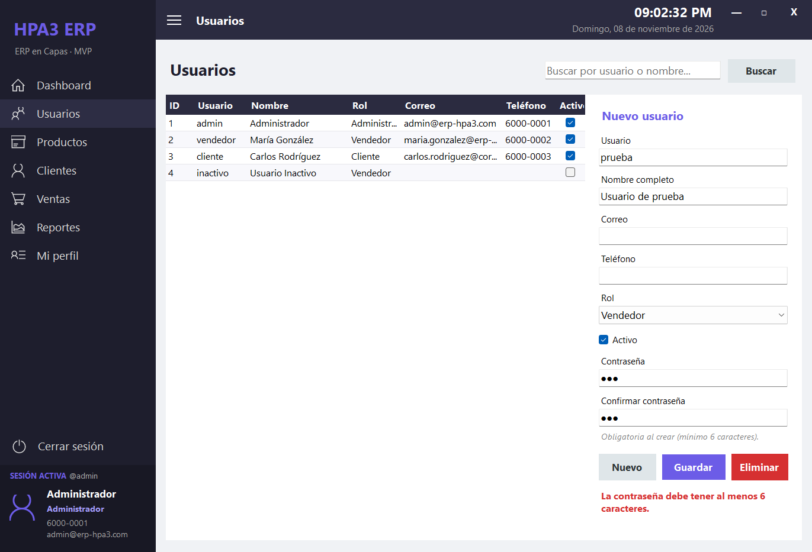 |

---

## ✅ Validaciones implementadas

| Dónde | Validación |
|---|---|
| Login | Campos vacíos (`ErrorProvider`), usuario o contraseña incorrectos (mismo mensaje, no revela qué usuarios existen), usuario inactivo |
| Usuarios / Crear cuenta | Campos obligatorios, sin espacios en el usuario, correo con formato válido, contraseña de 6+ caracteres y confirmación igual, usuario repetido, no eliminar/desactivar/cambiar el rol de la propia cuenta |
| Mi perfil | Contraseña actual correcta, nueva distinta a la actual |
| Productos | Código y nombre obligatorios, código único, precio > 0, stock ≥ 0 |
| Clientes | Nombre obligatorio, cédula única, correo válido |
| Ventas | Cliente seleccionado, carrito con productos, cantidad > 0, **stock suficiente** (en el carrito y otra vez dentro de la transacción del procedimiento) |
| Eliminaciones | No se elimina un producto, cliente o usuario con ventas registradas (se sugiere desactivarlo) |
| Permisos | Toda operación de Negocio verifica el rol antes de ejecutarse |
| Conexión | Si falla la base de datos se muestra el error en pantalla sin cerrar la app |

---

## 🧩 Controles utilizados

| Control | Uso |
|---|---|
| `Form` (sin bordes) | Login, ventana principal y formularios hijos dentro del panel contenedor |
| `Panel` / `FlowLayoutPanel` | Menú lateral, barra de título, panel de sesión, tarjetas del dashboard, paneles de edición |
| `Button` (`FlatStyle.Flat`) | Opciones del menú (generadas según el rol), acciones CRUD, ventana (cerrar/maximizar/minimizar) |
| `Label` / `LinkLabel` | Títulos, reloj, sesión, mensajes, iconos (Segoe MDL2 Assets), enlace "Crear cuenta" |
| `TextBox` | Datos y contraseñas (`UseSystemPasswordChar`) |
| `ComboBox` | Rol, cliente, producto, tipo de reporte |
| `NumericUpDown` | Precio, stock, stock mínimo, cantidad |
| `CheckBox` | Activo / mostrar contraseña |
| `DataGridView` | Listados, carrito, historial, detalle y reportes |
| `TabControl` | Nueva venta / Historial (Comprar / Mis compras) |
| `DateTimePicker` | Rangos de fechas en historial y reportes |
| `ErrorProvider` | Campos vacíos del login |
| `Timer` | Reloj (1 s) y animación del menú lateral |
| Dibujo GDI+ (`Paint`) | Gráfico de barras de reportes |

---

## ⚙️ Instalación y ejecución

### Requisitos
- Windows 10/11
- Visual Studio 2026 (o 2022 17.14+) con **Desarrollo de escritorio de .NET**
- .NET 10 SDK
- SQL Server 2022 Express + SSMS

### 1. Clonar el repositorio
```bash
git clone https://github.com/<usuario>/<repositorio>.git
cd <repositorio>
```

### 2. Activar la autenticación mixta en SQL Server
El login de privilegios mínimos es un login de SQL Server:
1. En SSMS, conectarse a `.\SQLEXPRESS` → clic derecho en el servidor → **Propiedades** → **Seguridad**.
2. Elegir **Modo de autenticación de SQL Server y de Windows** → Aceptar.
3. Clic derecho en el servidor → **Reiniciar**.

### 3. Crear la base de datos
Abrir `BaseDatos/script.sql` en SSMS y ejecutarlo (F5), o desde la terminal:
```bash
sqlcmd -S .\SQLEXPRESS -E -f 65001 -i BaseDatos\script.sql
```
> `-f 65001` le indica a `sqlcmd` que el archivo está en UTF‑8; sin esa opción las tildes (á, é, ñ) se guardan mal.

Crea la BD `ERP_HPA3`, las tablas, los procedimientos, los datos de ejemplo y el login `app_login_erp`. Se puede ejecutar varias veces.

### 4. Revisar la cadena de conexión
`CapaPresentacion/App.config` (cambiar `Server` si se usa otra instancia):
```xml
<add name="ConexionApp"
     connectionString="Server=.\SQLEXPRESS;Database=ERP_HPA3;User Id=app_login_erp;Password=ErpHPA3#2026!;TrustServerCertificate=True;Application Name=ERP_HPA3" />
```

### 5. Ejecutar
1. Abrir `Parcial_HPA3_Capas.slnx` en Visual Studio.
2. Clic derecho en **CapaPresentacion** → **Establecer como proyecto de inicio** (si no, aparece *"un proyecto de biblioteca de clases no se puede iniciar directamente"*).
3. Presionar **F5**.

Desde la terminal: `dotnet run --project CapaPresentacion`

### 6. Ejecutar las pruebas
En Visual Studio: **Prueba → Ejecutar todas las pruebas**, o:
```bash
dotnet test
```

### Usuarios de prueba
| Usuario | Contraseña | Rol |
|---|---|---|
| `admin` | `Admin123` | Administrador |
| `vendedor` | `Vendedor123` | Vendedor |
| `cliente` | `Cliente123` | Cliente |
| `inactivo` | `Inactivo123` | Vendedor inactivo (para probar la validación) |

---

## 🧪 Pruebas

- **33 pruebas unitarias** (xUnit, `CapaNegocio.Tests`) que no necesitan base de datos: generación y verificación del hash (incluida la compatibilidad con `HASHBYTES` de SQL Server), matriz de permisos, cálculo del ITBMS, reglas del carrito y validaciones. Son posibles porque la lógica vive en Negocio y en los presentadores, no en los formularios: esa es la ventaja de **capacidad de prueba** del MVP.
- **Prueba de integración** con la conexión real de privilegios mínimos (38 verificaciones): login de los 3 roles, CRUD de productos/clientes/usuarios, auto‑registro, cambio de contraseña, venta del vendedor con descuento de stock, venta rechazada por falta de stock, compra en línea del cliente, historial filtrado por rol y reportes.

---

## 📚 Referencias
- Ing. Irina Fong — *Laboratorio: Login de Usuario, Programación en capas* y *Rúbrica de Capas (Parcial Práctico)*.
- RJ Code Advance ES — [Formulario Plano Moderno, Menú animado, C#, WinForm](https://www.youtube.com/watch?v=y1jftnTaTXU)
- Microsoft Learn — [HASHBYTES (Transact‑SQL)](https://learn.microsoft.com/sql/t-sql/functions/hashbytes-transact-sql) · [Parámetros con valores de tabla](https://learn.microsoft.com/sql/relational-databases/tables/use-table-valued-parameters-database-engine) · [Microsoft.Data.SqlClient](https://learn.microsoft.com/sql/connect/ado-net/introduction-microsoft-data-sqlclient-namespace)

---

<sub>Elaborado por **Michael Hunt** · 1IL133 · 8 de noviembre de 2026</sub>
